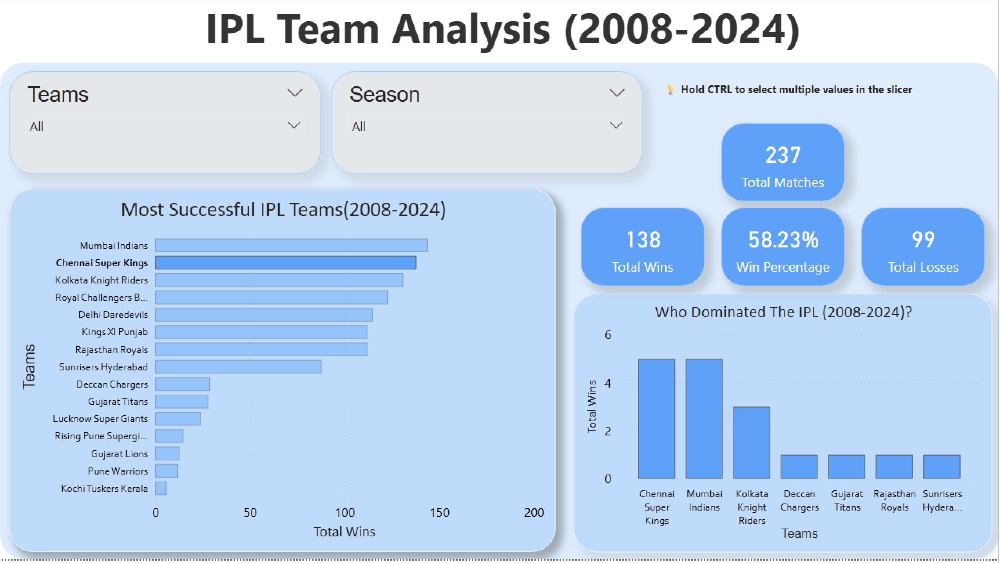
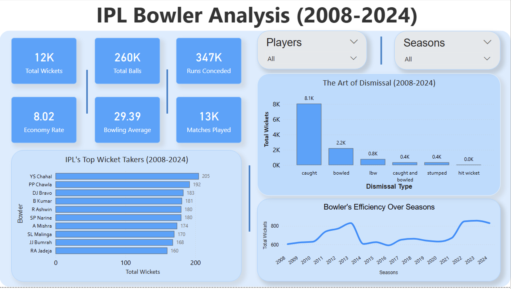

# IPL Data Analytics

An end-to-end IPL cricket data analysis project using **Python, SQL, and Power BI** to explore team performance, batting and bowling statistics, player performance, and match outcomes.

## Interactive Power BI Dashboard

**[Download the Power BI Dashboard (.pbix)](powerbi/IPL_Analysis_Dashboard.pbix)**

Download the dashboard file and open it in **Power BI Desktop** to interact with the report pages, filters, visualizations, and data model.

## Dashboard Preview

The Power BI report contains the following views:

### Team Analysis


### Batsman Analysis


### Player Performance Analysis


### Bowler Analysis


### Data Model


## Project Overview

The Indian Premier League (IPL) generates match-level and ball-by-ball data that can be used to analyze team and player performance.

This project uses IPL datasets to perform data cleaning, exploratory analysis, SQL-based querying, and dashboard development. The goal is to organize cricket data into useful statistics and interactive visualizations.

The repository includes:

- Python notebooks for data analysis
- Original IPL match and delivery datasets
- Cleaned datasets and derived statistical tables
- SQL queries for answering analytical questions
- An interactive Power BI dashboard
- Dashboard screenshots for quick preview

## Objectives

- Explore IPL match and ball-by-ball data.
- Analyze team performance and match wins.
- Examine batting statistics and run-scoring performance.
- Explore bowling statistics and wicket-taking performance.
- Compare player performance using calculated statistics.
- Investigate toss decisions and match outcomes.
- Present analytical results through an interactive Power BI dashboard.

## Tools and Technologies

| Tool | Purpose |
|---|---|
| Python | Data processing and analysis |
| Pandas | Data cleaning, manipulation, and aggregation |
| Jupyter Notebook | Exploratory analysis and documentation |
| SQL | Structured querying and statistical analysis |
| Power BI | Interactive dashboard and data visualization |

## Repository Structure

```text
IPL-Data-Analytics/
├── notebooks/
│   ├── ipl_analysis.ipynb
│   └── ipl_data_analysis.ipynb
├── data/
│   ├── CSV_main/
│   │   ├── matches.csv
│   │   └── deliveries.csv
│   └── CSV_cleaned/
│       ├── matches_cleaned.csv
│       ├── deliveries_cleaned.csv
│       ├── batting_stats.csv
│       ├── batting_stats_improved.csv
│       ├── bowling_stats.csv
│       ├── bowling_stats_improved.csv
│       ├── dismissal_stats.csv
│       └── dismissal_stats_improved.csv
├── sql/
│   └── ipl_queries.sql
├── powerbi/
│   └── IPL_Analysis_Dashboard.pbix
├── screenshots/
│   ├── team-analysis.png
│   ├── batsman-analysis.png
│   ├── player-performance.png
│   ├── bowler-analysis.png
│   └── data-model.png
└── README.md
```

## Data

### Original datasets

The `data/CSV_main/` directory contains the original CSV datasets used in the project:

- **`matches.csv`** — match-level information, including match details and outcomes.
- **`deliveries.csv`** — ball-by-ball information used for detailed batting, bowling, and match analysis.

### Cleaned and derived datasets

The `data/CSV_cleaned/` directory contains cleaned data and derived statistical tables:

- **`matches_cleaned.csv`** — cleaned match-level data.
- **`deliveries_cleaned.csv`** — cleaned ball-by-ball data.
- **`batting_stats.csv`** and **`batting_stats_improved.csv`** — batting statistics and improved versions of the analysis tables.
- **`bowling_stats.csv`** and **`bowling_stats_improved.csv`** — bowling statistics and improved versions of the analysis tables.
- **`dismissal_stats.csv`** and **`dismissal_stats_improved.csv`** — dismissal-related statistics and improved analysis tables.

The improved tables are retained alongside the earlier versions so the analysis outputs can be explored and compared.

## Python Analysis

The `notebooks/` directory contains the Jupyter notebooks used for analysis.

### `ipl_analysis.ipynb`

This notebook works with both the match-level and ball-by-ball datasets. It is intended for detailed exploratory analysis and statistical investigation using Python and Pandas.

### `ipl_data_analysis.ipynb`

This notebook focuses on analysis using the match-level dataset.

The notebooks use relative paths to access the original data from the repository structure.

## SQL Analysis

The SQL queries are available in **[`sql/ipl_queries.sql`](sql/ipl_queries.sql)**.

The queries investigate questions such as:

- Which teams have the most wins?
- Which batsmen have scored the most runs?
- Which bowlers have taken the most wickets?
- How do toss decisions relate to match outcomes?
- Which players rank highest based on the performance score used in the analysis?

These queries demonstrate the use of SQL for filtering, grouping, aggregation, sorting, and ranking analytical results.

## Power BI Dashboard

The Power BI report is available at:

**[`IPL_Analysis_Dashboard.pbix`](powerbi/IPL_Analysis_Dashboard.pbix)**

The dashboard contains views for:

- **Team Analysis** — team-level performance and match statistics.
- **Batsman Analysis** — batting and run-scoring statistics.
- **Player Performance Analysis** — player comparisons based on performance metrics.
- **Bowler Analysis** — bowling and wicket-taking statistics.
- **Data Model** — the relationships and structure used in the Power BI report.

The report is designed to let users explore the data through interactive visualizations and report controls.

## How to Explore the Project

### Option 1: View the Power BI dashboard

1. Open the repository’s `powerbi/` folder.
2. Download `IPL_Analysis_Dashboard.pbix`.
3. Open the file using Power BI Desktop.
4. Explore the report pages and interactive visuals.

### Option 2: Run the Python notebooks

1. Clone or download this repository.
2. Install Python and the required libraries, including Pandas and Jupyter.
3. Open the notebooks using Jupyter Notebook or JupyterLab.
4. Run the notebooks from the repository’s `notebooks/` directory.
5. Ensure the datasets remain in the `data/CSV_main/` directory so the relative paths resolve correctly.

### Option 3: Explore the SQL queries

1. Open `sql/ipl_queries.sql`.
2. Review the analytical queries.
3. Run them in a compatible SQL environment after loading the relevant data into tables.

## Key Project Components

| Component | Description |
|---|---|
| Data preparation | Original and cleaned IPL datasets |
| Python analysis | Notebook-based exploration and statistical analysis |
| SQL analysis | Queries for team, batting, bowling, toss, and player performance |
| Power BI | Interactive dashboard with multiple analysis pages |
| Documentation | README and dashboard screenshots |

## Author

Created as an IPL Data Analytics project using Python, SQL, and Power BI.

